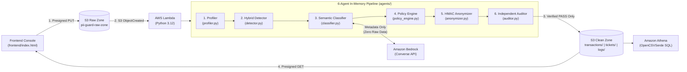

# AWS Multi-Agent PII Guard

An automated, serverless data-sanitization pipeline on AWS that detects, masks, and deterministically hashes Personally Identifiable Information (PII) in raw CSV datasets using a **6-agent architecture**, **Amazon Bedrock**, and **keyed HMAC-SHA256 cryptography**. Sanitized datasets are independently audited before publication to an S3 Clean Zone for safe analytics in **Amazon Athena**, **Tableau**, and **Excel**.

---

## Architecture Overview



---

## The 6-Agent Workflow

All six logical agents execute sequentially in RAM inside a single AWS Lambda invocation (`run_pii_pipeline(raw_csv_text, salt)` in [`agents/pipeline.py`](agents/pipeline.py)):

1. **Profiler Agent ([`agents/profiler.py`](agents/profiler.py)):** Validates RFC 4180 CSV structure, headers, and row uniformity. Computes per-column metadata (`data_type`, `null_percentage`, `cardinality_ratio`, `free_text`, and `ambiguous` flags) without storing raw values.
2. **Hybrid Detector Agent ([`agents/detector.py`](agents/detector.py)):** Scans cells using compiled regular expressions and mathematical checksums:
   - **Luhn Checksum:** Validates 13–19 digit credit card numbers.
   - **Verhoeff Checksum:** Validates 12-digit Aadhaar numbers.
   - **Pattern Matchers:** Emails, Indian & international phone numbers, PAN cards, IPv4 addresses, and dates of birth.
3. **Semantic Classifier Agent ([`agents/classifier.py`](agents/classifier.py) & [`llm/bedrock_provider.py`](llm/bedrock_provider.py)):** Resolves ambiguous columns by sending **column metadata only** (never cell values) to **Amazon Bedrock** (`amazon.nova-micro-v1:0` via the Converse API). Enforce fail-closed security: the LLM cannot downgrade an unknown column to `NON_PII`.
4. **Policy Engine Agent ([`agents/policy_engine.py`](agents/policy_engine.py)):** Assigns a deterministic transformation action per column:
   - `hash`: Deterministic per-column HMAC-SHA256 token (`eml_v1_<24-hex>`, `usr_v1_<24-hex>`, `pan_v1_<24-hex>`).
   - `mask_last4`: Redacts all but the final 4 digits (`***3210`).
   - `scrub_text`: Preserves free-text ticket sentences while scrubbing inline PII and cross-referenced customer names.
   - `keep`: Preserves non-sensitive analytical fields (`transaction_id`, `amount`, `transaction_date`).
5. **Anonymizer Agent ([`agents/anonymizer.py`](agents/anonymizer.py)):** Applies the policy transformations in memory using keyed HMAC-SHA256 and escapes CSV formula-injection payloads (`=`, `+`, `-`, `@`).
6. **Independent Auditor Agent ([`agents/auditor.py`](agents/auditor.py)):** Re-profiles and re-scans the sanitized CSV to verify row-count parity, formula safety, and zero residual PII leaks. Only datasets that achieve `status: "PASS"` are published to the S3 Clean Zone.

---

## Repository Structure

```text
├── agents/
│   ├── pipeline.py        # Main orchestrator: run_pii_pipeline(raw_csv_text, salt)
│   ├── profiler.py        # Agent 1: CSV validation & value-free metadata profiling
│   ├── detector.py        # Agent 2: Regex + Luhn/Verhoeff checksum PII detection
│   ├── classifier.py      # Agent 3: Deterministic + LLM metadata classification
│   ├── policy_engine.py   # Agent 4: Fail-closed column transformation policy
│   ├── anonymizer.py      # Agent 5: Per-column HMAC-SHA256 & inline text scrubber
│   └── auditor.py         # Agent 6: Independent post-anonymization audit gate
├── llm/
│   ├── base.py            # LLMProvider protocol interface
│   ├── bedrock_provider.py# Amazon Bedrock Converse API adapter (default)
│   └── groq_provider.py   # Optional Groq LLM adapter
├── infra/
│   └── lambda_function.py # AWS Lambda S3 event handler
├── frontend/
│   └── index.html         # Single-page web console (S3 presigned upload/poll + Excel export)
└── datasets/              # Sample CSV datasets for testing
    ├── bank_transactions.csv
    ├── customer_support_tickets.csv
    ├── edge_cases.csv
    └── pii_dataset_first_10.csv
```

---

## Quick Start & Local Verification

Because the core pipeline uses Python 3.12 standard libraries (`csv`, `hmac`, `hashlib`, `io`, `re`) and AWS Lambda's built-in `boto3`, no heavy third-party packages (`pandas`, `spaCy`, `torch`) are required.

```powershell
# Run a quick local verification against the sample datasets
python -c "from pathlib import Path; from agents.pipeline import run_pii_pipeline; [print(p.name, '->', run_pii_pipeline(p.read_text(encoding='utf-8'), 'local_dev_salt')[1]['status']) for p in sorted(Path('datasets').glob('*.csv')) if p.name != 'pii_dataset.csv']"
```

---

## Packaging & Deploying to AWS Lambda

1. **Environment Variables (Lambda Console):**
   - `PII_SALT`: Secret master key for HMAC-SHA256 tokenization.
   - `CLEAN_BUCKET`: Target S3 Clean Zone bucket name.
   - `LLM_PROVIDER`: `bedrock` (default) or `disabled`.
   - `BEDROCK_MODEL_ID`: `amazon.nova-micro-v1:0` (or any model enabled in Amazon Bedrock).
2. **IAM Role Permissions:**
   - `AmazonS3FullAccess` (or scoped `s3:GetObject` on Raw Zone and `s3:PutObject` on Clean Zone).
   - `AmazonBedrockFullAccess` (or `bedrock:InvokeModel` on your selected Bedrock model).
3. **Build Deployment `.zip`:**
   ```powershell
   Remove-Item -Recurse -Force build, pii-guard-lambda.zip -ErrorAction SilentlyContinue
   New-Item -ItemType Directory -Path build | Out-Null
   Copy-Item infra\lambda_function.py build\lambda_function.py
   Copy-Item -Recurse agents build\agents
   Copy-Item -Recurse llm build\llm
   Get-ChildItem -Path build -Recurse -Directory -Filter "__pycache__" | Remove-Item -Recurse -Force
   Compress-Archive -Path build\* -DestinationPath pii-guard-lambda.zip
   Remove-Item -Recurse -Force build
   ```
